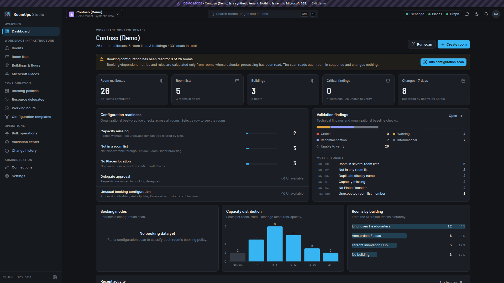
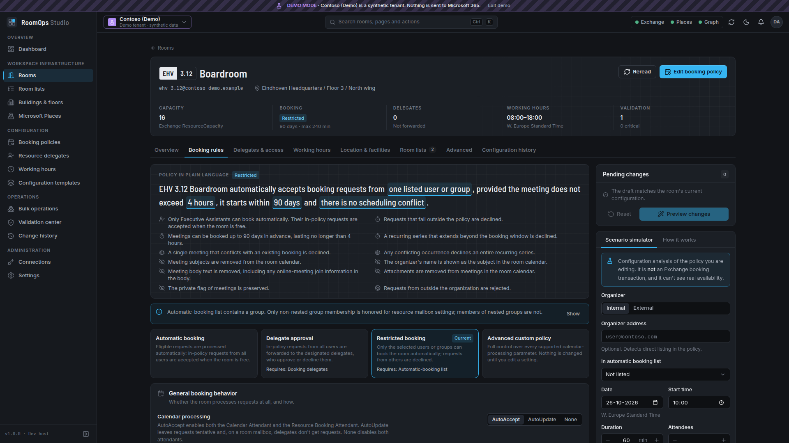
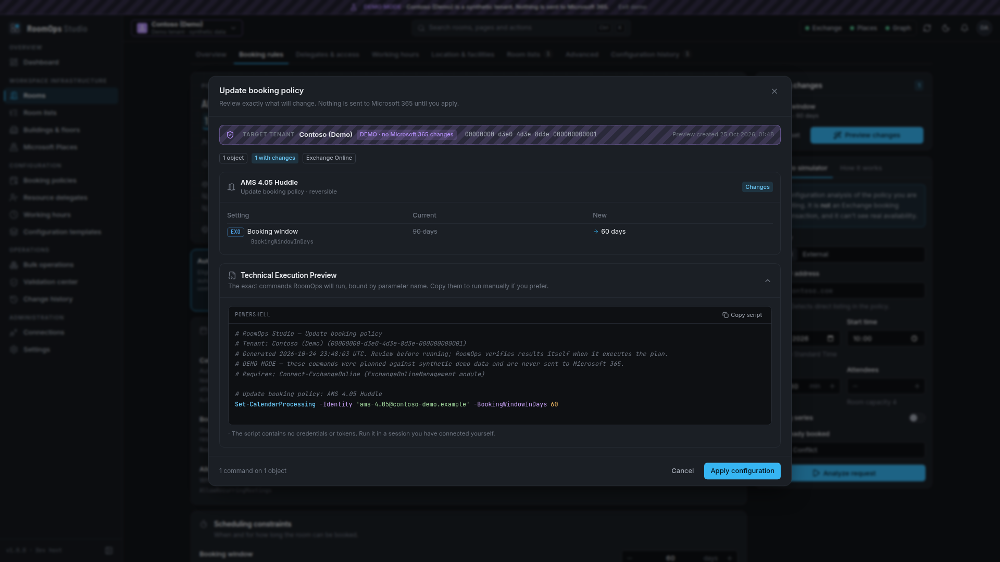
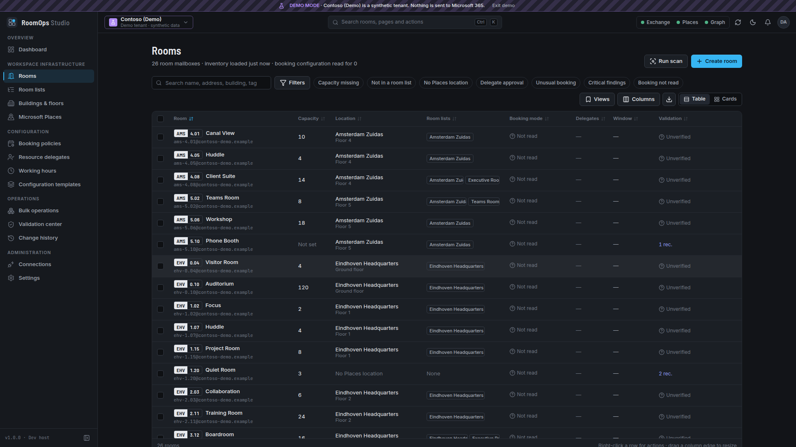
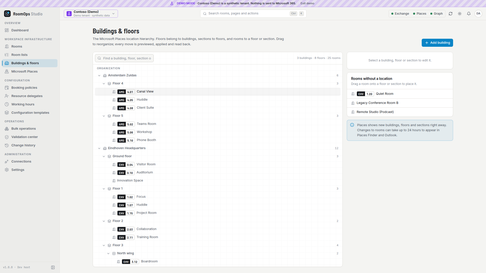

# RoomOps Studio

**Intelligent Workspace Administration** — a Windows desktop console for Microsoft 365 meeting rooms.

RoomOps Studio brings Exchange Online room mailboxes, room lists, booking policies, resource delegates, working hours and the Microsoft Places location hierarchy into one graphical workflow. Every change is **previewed, confirmed, executed, read back and recorded**, and the exact PowerShell behind it is always one click away.



| Booking policy designer | Change preview |
|---|---|
|  |  |

| Room inventory | Buildings & floors (light) |
|---|---|
|  |  |

---

## Status at a glance

> A successful build does not prove that Microsoft 365 operations succeed in a real tenant. Read this table before relying on RoomOps in production.

| Area | Status |
|---|---|
| Domain rules, policy explainer, simulator, validation engine | **Implemented · unit-tested** (74 tests) |
| Command allowlist, PowerShell quoting, error classification | **Implemented · unit-tested** (24 tests) |
| Change pipeline (plan → confirm → execute → verify → audit), stale detection, tenant binding, retries, provisioning waits, revert, resume | **Implemented · integration-tested against the demo tenant** (20 tests) |
| PowerShell 7 worker process (protocol, allowlist, nonce, literal binding, crash handling) | **Implemented · contract-tested with real pwsh 7.4** and a stand-in module (14 tests) |
| Bridge dispatcher and persistence | **Implemented · tested** (8 tests) |
| User interface | **Implemented · Playwright-tested in demo mode** (17 flows + screenshot capture in both themes at 1920×1080 and 1366×768) |
| Windows desktop shell (WPF + WebView2) | **Implemented · runs on Windows** (`RoomOpsStudio.exe`, self-contained win-x64). |
| MSI installer | **Implemented · install, upgrade, downgrade block and uninstall tested under Wine 9.** Not yet installed on Windows. |
| Exchange Online, Microsoft Places and Microsoft Graph live operations | **Implemented · partly verified live.** Exchange Online inventory, the configuration scan and recipient search are in use on a live tenant. Verify the other live operations before relying on them; see [VERIFICATION](docs/VERIFICATION.md). |

## What it does

- **Dashboard** — real inventory metrics, configuration readiness, validation findings and recent changes. Booking-dependent metrics are shown only for rooms whose configuration has been read; nothing is estimated.
- **Rooms** — virtualized inventory with search, multi-filters, saved views, resizable columns, CSV export, selection-driven bulk actions and a card view. Room detail separates the **Exchange mailbox** from the **Places room object** and shows the authoritative source of every property.
- **Create room** — guided wizard: identity with live uniqueness checks, Places location (with inline building/floor creation), facilities, booking preset, working hours, room list. Exactly one object-creating command is used (`New-Mailbox -Room` *or* `New-Place -Type Room`), and provisioning stages are reported honestly.
- **Booking policy designer** — four booking access models (everyone, selected users only, delegate approval, hybrid) that set and clear the underlying permissions for you, recognized again when a room is opened, with a live summary; and every documented `Set-CalendarProcessing` parameter for Exchange Online under advanced configuration, presented as a plain-language policy sentence that follows each edit, a permission matrix, privacy previews, validation of parameter interactions and a **scenario simulator** that is explicitly a configuration analysis.
- **Resource delegates** — booking delegates and calendar-folder permissions (localized folder names handled), with Full Access, Send As and Send on Behalf shown separately and never granted as a side effect.
- **Working hours** — visual weekly editor that respects the Exchange model (one range for all work days) with time-zone and daylight-saving context.
- **Room lists** — create, rename, add/remove members, controlled conversion of distribution groups, and a drag-and-drop board that turns moves into reviewed membership changes.
- **Buildings & floors / Microsoft Places** — location explorer with drag-and-drop reparenting that enforces the documented hierarchy rules, metadata editing, and a Room Finder vs Places Finder diagnostic. Tenant-wide Places settings are read-only.
- **Configuration templates** — sparse, reusable settings with JSON import/export, before/after comparison and per-room exceptions.
- **Bulk operations** — CSV/JSON import (comma or semicolon), column mapping, type and duplicate validation, per-object preview, throttled execution, failure export and retry of unresolved items after revalidation.
- **Validation center** — technical findings (documented behavior) separated from configurable organizational-baseline checks; *Unable to verify* when data hasn't been read; one-click remediation through the same pipeline.
- **Change history** — application-local audit with before-state, executed commands and verification; HTML change reports, JSON export, restore previous values, resume provisioning steps and re-verify Places propagation.
- **Teams Rooms readiness** — license, account and calendar signals from Microsoft Graph, reported as unverifiable when Graph isn't available.
- **English and Dutch** — an EN | NL switch at the top right changes the entire interface, including backend explanations and findings.
- **Demo mode** — a clearly labeled synthetic tenant (26 rooms, 3 buildings, 5 room lists, delegate and validation scenarios). It runs the real planning and verification pipeline but never contacts Microsoft 365.

## Requirements

**To run RoomOps Studio (Windows 10 21H2+ / Windows 11, x64):**
- Microsoft Edge WebView2 Runtime (preinstalled on Windows 11).
- PowerShell 7.2 or later (`pwsh`).
- Microsoft's modules, installed for your user:
  ```powershell
  Install-Module ExchangeOnlineManagement -Scope CurrentUser   # 3.7.2 or later
  Install-Module MicrosoftPlaces -Scope CurrentUser            # 2.0.0 or later (optional, for Places)
  Install-Module Microsoft.Graph.Authentication -Scope CurrentUser  # optional, for Teams Rooms readiness
  ```
- An administrator account with the roles described in [CAPABILITY-MATRIX](docs/CAPABILITY-MATRIX.md). Global Administrator is not required.

The self-contained package includes the .NET runtime.

**To build:** .NET SDK 10, Node.js 20+ (tested with 26), npm. Python 3 is used by `build.sh` to zip the package. Optional installers: `wixl` from msitools (Linux, macOS or WSL) produces the MSI; Inno Setup 6 (Windows) produces the per-user setup.

## Build and run

```bash
./build.sh                 # contract check, frontend checks + bundle, .NET build + tests, win-x64 package and MSI
./build.sh --e2e           # additionally runs the Playwright UI tests (demo mode)
```
```powershell
./build.ps1                # same on Windows; also builds the installer when Inno Setup is installed
./build.ps1 -E2E
```

Outputs:
- `artifacts/RoomOpsStudio-<version>-win-x64.zip` — portable, self-contained application (`RoomOpsStudio.exe`).
- `artifacts/RoomOpsStudio-<version>-win-x64.msi` — per-machine Windows Installer package (`build.sh` with msitools only).
- `artifacts/RoomOpsStudio-<version>-setup.exe` — per-user installer (Windows build with Inno Setup only).

### Installing

Ready-made packages (MSI and portable zip) are attached to each version on the repository's **Releases** page. What changed in each version is in [CHANGELOG.md](CHANGELOG.md).

The MSI installs for all users in `C:\Program Files\RoomOps Studio` and adds **RoomOps Studio** to the Start menu. Installing needs administrator rights; the application itself runs without elevation. The MSI has no setup wizard: Windows Installer shows its standard progress window.

```powershell
msiexec /i RoomOpsStudio-<version>-win-x64.msi                                # interactive
msiexec /i RoomOpsStudio-<version>-win-x64.msi /qn /l*v install.log           # silent, for Intune or Configuration Manager
msiexec /i RoomOpsStudio-<version>-win-x64.msi INSTALLDIR="D:\Apps\RoomOps Studio"
msiexec /x RoomOpsStudio-<version>-win-x64.msi /qn                            # uninstall
```

A newer MSI replaces an installed older version; installing an older version over a newer one is refused. Settings, templates and history in `%LOCALAPPDATA%\RoomOps Studio` are kept when you upgrade or uninstall. The WebView2 Runtime is checked when the application starts, not during installation.

### Development

```bash
# Backend + browser UI against the development host (demo mode only, loopback, token-protected)
dotnet run --project src/RoomOps.DevHost -- --port 5199 --static "$PWD/web/dist"
# open the printed URL (it contains a one-time ?devtoken=…)

# Hot-reloading frontend
cd web && npm run dev       # proxies /bridge to the dev host on 5199
dotnet run --project src/RoomOps.DevHost -- --port 5199 --dev-origin http://localhost:5173

# Regenerate the TypeScript bridge contract after changing a bridge type
cd web && npm run contracts
```

The dev host refuses live Microsoft 365 connections unless started with `--allow-live`.

### Tests

```bash
dotnet test RoomOps.slnx                         # domain, application, integration, worker contract tests
cd web && npx vitest run                         # frontend unit tests
cd web && npx playwright test e2e/app.spec.ts    # UI flows (starts the dev host automatically)
cd web && npx playwright test e2e/screenshots.spec.ts   # screenshots of every screen, both themes, two resolutions
```

## Repository layout

```
src/
  RoomOps.Domain          Policy model, validation rules, explainer, simulator, hierarchy, templates (no dependencies)
  RoomOps.Application     Command allowlist, sessions, gateways, change planners, execution engine, services
  RoomOps.Infrastructure  PowerShell worker host + script, demo tenant, SQLite audit/templates, settings, session manager
  RoomOps.Bridge          Typed bridge registry, dispatcher, contracts, host abstractions
  RoomOps.Hosting         Composition root, Serilog with token redaction, environment probe
  RoomOps.Desktop         WPF + WebView2 Windows shell (RoomOpsStudio.exe)
  RoomOps.DevHost         Loopback development host for browser-based development and UI tests
tools/RoomOps.ContractGen Generates web/src/bridge/contracts.gen.ts from the bridge registry
tests/                    xUnit test projects
web/                      React 19 + TypeScript frontend (Vite, Tailwind, Radix, TanStack, Motion), Playwright tests
installer/                MSI definition (RoomOpsStudio.wxs) and Inno Setup script
docs/                     Architecture, security, capability matrix, user guide, limitations, verification
```

## Documentation

- [User guide](docs/USER-GUIDE.md)
- [Architecture](docs/ARCHITECTURE.md)
- [Security](docs/SECURITY.md)
- [Capability matrix](docs/CAPABILITY-MATRIX.md) — feature → service → cmdlet → permission → validation → limitations
- [Known limitations](docs/KNOWN-LIMITATIONS.md)
- [Verification results](docs/VERIFICATION.md)
